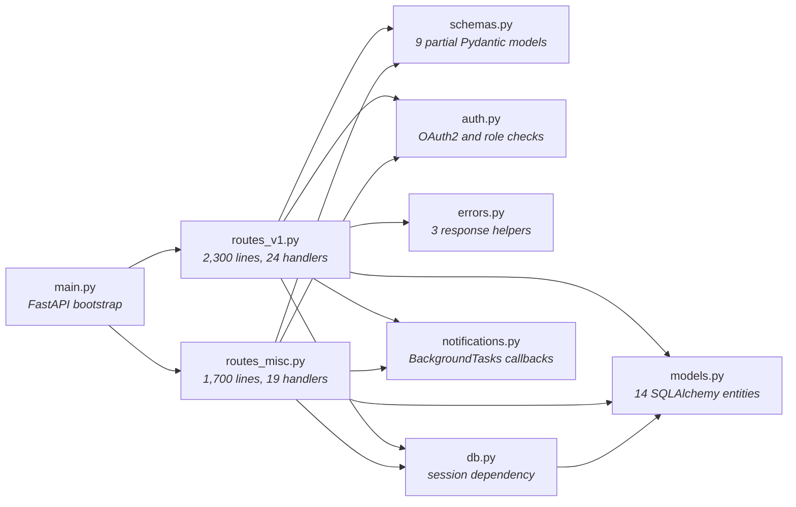

# Bookbay Versioned Api Core Design — Software Design Document

| | |
|---|---|
| **Status** | Documents the current system |
| **Last updated** | 2026-09-03 |

## 1. Introduction & Overview

Bookbay connects students who are selling used textbooks with buyers at nearby universities. Its mobile application and public API have grown for three years as one FastAPI deployment backed by PostgreSQL. A signed distribution partner now needs a stable API and generated client within one quarter. The current mobile release cannot be force-upgraded, and a long tail of installed versions will remain active for at least six months. Checkout correctness is commercially important because each listing normally represents one physical book and customer support must reverse any accidental second charge manually.

**Objective of this document:** describe the system as it runs today — its architecture, data, interfaces and components. The design goal: Bookbay’s three-year FastAPI monolith exposes inconsistent contracts and can create two orders when mobile retries a timed-out checkout, putting its new partner integration and customer trust at risk. The candidate reviews the coupled route-module design and replaces it on the board with a migration-safe REST contract and testable router, schema, service, and persistence boundaries. A strong submission reasons about backward compatibility, HTTP semantics, transaction-scoped idempotency, stable client contracts, and test seams rather than merely splitting files into more boxes.

## 2. System Architecture

The main.py module constructs the FastAPI application and includes routers from routes_v1.py and routes_misc.py. The first route module contains 24 user and order handlers, while the second contains 19 listing, search, cancellation, and refund handlers. Both modules obtain SQLAlchemy sessions from db.py, query entities from models.py directly, perform business decisions inline, and manually construct many response dictionaries. The schemas.py module contains nine Pydantic models, but several listing and order handlers accept dictionaries or return ORM-derived dictionaries instead. The auth.py dependency decodes OAuth2 tokens and performs role checks inside individual handlers. The errors.py module provides three response helpers used by only part of routes_v1.py, while other handlers return their own error bodies or allow exceptions to escape. Both route modules also schedule callbacks from notifications.py after selected order operations.

> The architecture diagram below is the same system that is pre-drawn (locked) on the whiteboard for this task; this repository contains its implementation.

### 2.1 Architecture Diagram (current system)

| Component | Role |
|---|---|
| main.py | FastAPI bootstrap |
| routes_v1.py | 2,300 lines, 24 handlers |
| routes_misc.py | 1,700 lines, 19 handlers |
| schemas.py | 9 partial Pydantic models |
| auth.py | OAuth2 and role checks |
| errors.py | 3 response helpers |
| db.py | session dependency |
| models.py | 14 SQLAlchemy entities |
| notifications.py | BackgroundTasks callbacks |

### 2.2 Known Limitations (observed in production)

Clients receive different field names for the same listing depending on which route produced it, and generated partner models cannot represent all variants cleanly. Collection endpoints use three pagination styles with different defaults, limits, and end-of-list behavior. An audit of failed requests found status-200 error bodies, conventional 4xx responses, and uncaught 500 responses containing internal exception text. Mobile checkout requests occasionally cross the client’s three-second timeout even though the database operation completes shortly afterward. In two confirmed cases, the automatic retry committed another order for the same user, cart, and cart version within seconds. Contract changes are slow because route tests require a real database fixture and assertions often depend on hand-built response dictionaries.

## 3. Component Design

| Component | Implementation |
|---|---|
| main.py | `app/__init__.py`, `app/main.py` |
| db.py | `app/db.py` |
| models.py | `app/models.py` |
| schemas.py | `app/schemas.py` |
| auth.py | `app/auth.py` |
| errors.py | `app/errors.py` |
| notifications.py | `app/notifications.py` |
| routes_v1.py | `app/routes_v1.py` |
| routes_misc.py | `app/routes_misc.py` |

## 4. Assumptions, Constraints & Scale

Bookbay serves about 180,000 daily active users and averages 1,500 requests per minute, which is approximately 2.16 million requests or 12 requests per active user each day. Back-to-school peaks reach 4,500 requests per minute, or 75 requests per second, with 60 read requests and 15 write requests per second at the peak mix. The platform receives roughly 9,000 order-creation attempts and commits about 8,600 orders per day. Under normal PostgreSQL health, the new API should keep read requests below 250 ms p95 and order creation below 700 ms p95 without waiting for notifications. The implementation must remain a single FastAPI deployable using Pydantic, SQLAlchemy, and PostgreSQL; introducing a new distributed data platform is outside the quarter’s budget. Order and refund records are retained for seven years, API logs for 30 days, and replayable idempotency responses for at least seven days. The partner contract must freeze within one quarter, while legacy behavior cannot be removed or broken during the six-month mobile compatibility window.

## 5. Glossary

- **Idempotency key** — A client-supplied token that lets the server recognize retries of the same unsafe operation and replay its result.
- **Problem details** — A standardized JSON error shape that separates stable machine-readable fields from human-readable explanation.
- **Cursor pagination** — Pagination that resumes after an opaque position in a stable ordering instead of using a numeric row offset.
- **Repository interface** — An application-facing abstraction for loading and saving domain data without exposing ORM or storage details.
- **Compatibility adapter** — A boundary that translates a legacy request or response contract to a newer internal service without breaking existing clients.
